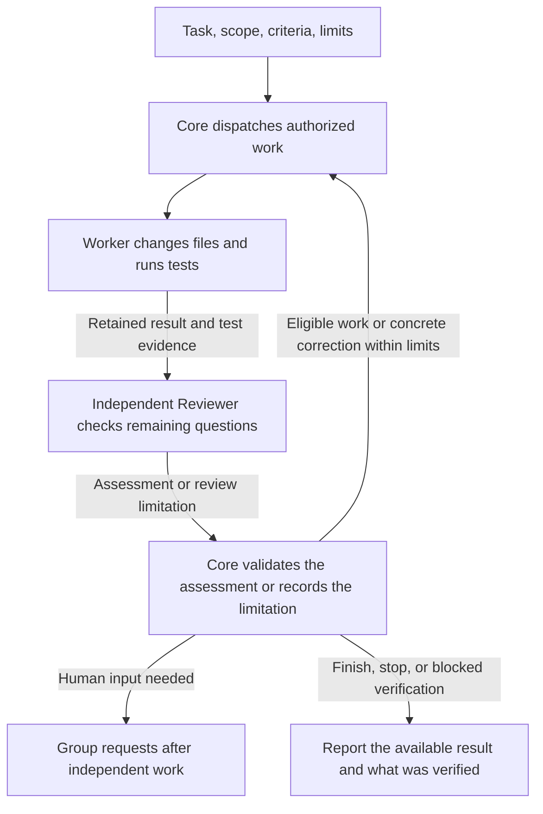

# Pi Ping Pong

Pi Ping Pong is a local controller for running a coding task in Pi with explicit scope, acceptance criteria, and finite execution limits. A Worker does the work; a separate Reviewer checks what its tests and other evidence do not settle. Core decides whether to continue, wait, stop, or record verified acceptance.

**Experimental (0.x).** The workflow and compatibility may change. Use it on tasks where you can inspect the results; local checks do not establish live model acceptance.

A passing test suite answers only the questions it actually checks. A Worker can finish with a green suite and still miss a requirement, change something outside scope, or leave the result hard to verify. The point of the separate review is to examine those gaps, not to run the same tests again or to treat a second model's opinion as proof.

Core keeps working on eligible actions when another action is blocked. If review is unavailable or evidence is incomplete, Core preserves the result and reports what remains unverified. Uncertainty alone does not send the Worker back to make another change. Verified acceptance (`finish`) requires all criteria to pass, completed actions, resolved blockers, and reconciled effects; neither native completion nor a Reviewer endorsement is enough.

## Execution modes

| Worker mode | When independent review happens | Main Worker limits |
|---|---|---|
| **Ping-pong** | After each settled ordinary Pi Worker iteration. | Cumulative iterations and active Worker time; per-iteration time and a separate checkpoint-repair bound. |
| **Goal** | After a native Goal completes or reaches a real limit, not after every progress checkpoint. Corrections keep the same Pi history. | Cumulative active Worker time and number of native Goal launches; optional cumulative token cap. |
| **Ralph** | After a bounded native multi-iteration loop returns a result or reaches a real limit. | Cumulative native iterations and active Worker time; per-iteration time. |

Review has its own finite deadline. Corrections use remaining allowance rather than opening a new run budget. See the [run contract](references/reviewed-runs.md) for grants, recovery, and exact accounting.

## Get started

1. Until the first npm release, install with `pi install git:github.com/SzpakLabs/pi-ping-pong`. Once published, the npm alternative is `pi install npm:pi-ping-pong`. Use one source only. Python 3.10+ must already be on `PATH` as `python3`. If you used the old copy installer, [disable the copied receiver first](docs/GUIDE.md#migrate-from-the-copy-installer). See the [guide](docs/GUIDE.md#install) for prerequisites, updates, and the Codex skill.
2. Open Pi in the project you want the Worker to edit. Run `/reload` if you just installed the receiver. New runs use `.pi/ping-pong/runs/`; [Git exclusion is best effort](docs/project-workspace.md#private-run-storage), not a preparation or launch requirement.
3. Describe the task, allowed paths, and how you'd judge the result. Run `/ppp <name>` with an unused lowercase kebab-case name. Review the generated `TASK.md`, `config.json`, models, and limits. Preparation does not start the Worker.
4. Run `/ppp <name>` again when the draft is ready and you want to launch. Use `/ppp-status` to inspect it. With headless review, the launching chat reports progress and collects confirmed human responses through `/ppp-respond`; a separate Pi session reviews the result.

Example task: “Add a dark-mode toggle. Limit edits to `src/` and `tests/`. The preference should survive reload and the toggle must work by keyboard. Run the project's tests and report any browser behavior you couldn't verify. Prepare the run with finite limits, but don't launch yet.”

## Boundaries

- **Works in place.** The Worker acts on the selected project, including uncommitted files. Keep private run records out of version control. The default headless Reviewer has read-only built-in tools, but this is not an OS sandbox. Task scope and budgets grant no commit, push, or deploy permission.
- **Local runtime, configured model access.** Keep the host and Pi reporting session available. Model calls may incur usage charges. Codex is an optional review transport with [its own prerequisites](docs/GUIDE.md#quick-start-reviewer-in-codex); it is not a Worker mode. No Claude Code runtime or specific Claude model/provider combination is verified here.
- **No in-place migration.** Existing `.pi-ping-pong/runs/` runs stay discoverable at their original paths. Prepare new protocol 2 / schema 1 runs without a separate evaluator. Protocol 1 and evaluator-era configs/runs cannot launch or resume on this runtime; their files are left alone.
- **Local checks are not live validation.** Tests with synthetic processes check runtime behavior, not model judgment, provider compatibility, or unattended operation after closing the launching UI. [Manual validation](docs/manual-e2e.md) is separate.

[User guide](docs/GUIDE.md) · [Full source documentation](https://github.com/SzpakLabs/pi-ping-pong/tree/main/docs) · [Skill](SKILL.md) · [MIT License](LICENSE)
