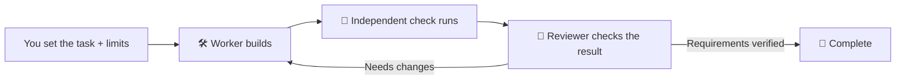

<div align="center">

# 🏓 Pi Ping Pong

### One AI builds. Another checks. Feedback goes back automatically.

Give your coding agent a second pair of eyes—without copying messages between chats.

**Pi · Goal / Ralph · Pi or Codex reviewer**

[Get started](#get-started) · [Full guide](docs/GUIDE.md) · [Roadmap](docs/ROADMAP.md) · [Documentation](docs/README.md)

</div>

---

## Less copy-paste. More checked work.

You ask an AI to build something. It says “done.” You check it, find a problem, and paste feedback into its chat. Repeat.

Pi Ping Pong connects those steps. A **worker** changes your files. A separate **reviewer** checks the result and a fresh task-specific test, then sends feedback back to the worker. They repeat within limits you choose.



For example: ask for a dark-mode toggle with tests. The worker builds it; checks and review catch missing requirements; feedback returns automatically.

## What you get

- **A second review.** A separate AI session checks the worker's result.
- **Checks beyond “looks done.”** A task-specific test runs independently at each review point.
- **Automatic feedback.** Corrections return to the worker; no manual chat relay.
- **Bounded runs.** You choose cycle and time limits. Real blockers come back to you.
- **Your choice of agents.** Pi runs the worker through Goal or Ralph; review happens in Pi or Codex.

## Get started

You'll need **macOS or Linux**, **Python 3.9+**, **Node.js 22.19+**, and a configured **Pi CLI with Goal/Ralph extensions and model access**. New to Pi? Follow the [requirements and dependency setup](docs/GUIDE.md#requirements) first. Codex is optional for the Pi review route.

### 1. Install from the checkout

```sh
git clone https://github.com/SzpakLabs/pi-ping-pong.git
cd pi-ping-pong
python3 scripts/install.py
```

The installer copies the skill and Pi receiver, backing up differing files. Install Pi, Goal/Ralph, and credentials separately. [Installation details →](docs/GUIDE.md#install)

### 2. Describe your task in Pi

Open Pi in your project. Add `.pi-ping-pong/` to that project's `.gitignore` so private run files stay out of Git. After installation, run:

```text
/reload
```

Tell Pi what to build, how to check it, which files it may change, and which worker provider/model to use. For example:

> Add a dark-mode toggle and tests. You may edit src/ and tests/. Help me choose an available worker model, a test command, and finite cycle/time limits. Prepare the run without launching it.

Then choose a short run name:

```text
/ppp dark-mode
```

This prepares the task, check, and settings using your conversation. Answer any missing-input questions, then review the generated files and limits.

### 3. Launch when ready

Run the same command again to start the prepared run:

```text
/ppp dark-mode
```

Check progress with `/ppp-status`. Use `/ppp` to open the runs menu. Feedback returns to this Pi conversation; keep Pi and the host running. A previously launched name shows status—use a new name for new work.

Prefer reviewing in Codex? Follow the [Codex setup](docs/GUIDE.md#quick-start-reviewer-in-codex).

## Know before you run

**Local prototype.** Setup takes some terminal work; compatibility depends on your environment. [Validation status and limitations →](docs/GUIDE.md#goal-and-ralph-modes)

Both agents need access to the same files. They use your configured model access and can consume paid usage. A passing test or an AI saying “done” does not prove every requirement or visual detail is correct. Run limits do not provide an operating-system sandbox or grant commit, push, or deploy permission.

## Go deeper

| Looking for… | Read |
|---|---|
| Setup, versions, daily commands, Codex, mobile, and limitations | [User guide](docs/GUIDE.md) |
| Config files, review decisions, transport, and recovery boundaries | [Run contract](references/reviewed-runs.md) |
| Instructions for your AI agent | [Skill](SKILL.md) |
| Proposed future work and design | [Roadmap](docs/ROADMAP.md) · [Target architecture](docs/ARCHITECTURE.md) |
| Development checks and maintenance rules | [Development guide](docs/GUIDE.md#development-checks) · [AGENTS.md](AGENTS.md) |

---

[MIT License](LICENSE) · Copyright © 2026 Artem Litvinko
