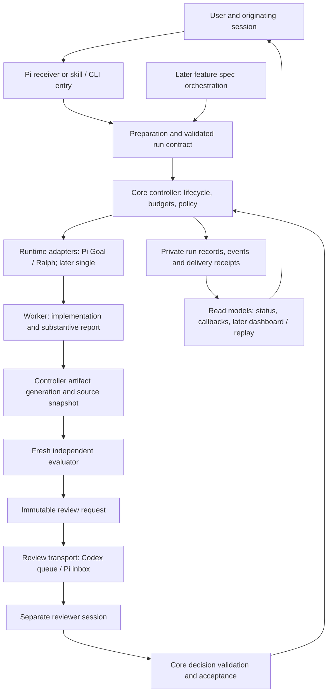

# Pi Ping Pong — Target Architecture

Date: 2026-10-18 · Architecture revision: 1

Status: desired architecture recorded for review. This document defines the target and its constraints; it does not claim owner sign-off on new proposals, completed implementation, live compatibility, or release readiness. It authorizes no runtime refactor, paid run, commit, publication or external action.

## 1. Purpose and document authority

Pi Ping Pong is a local-first supervision layer for existing coding agents: authorized work, bounded execution, fresh independent evaluation, separate review, and an evidence-backed outcome returned to the originating session.

The architectural unit is **one supervised run**, not a chat transcript or a model invocation. A run owns its task contract, source scope, budgets, worker lifecycle, review history and outcome. Core owns the rules; models provide implementation and judgment within them.

| Document | Authority |
|---|---|
| This document | Desired component boundaries, ownership, invariants and extension rules. Changes to these decisions must be recorded here. |
| [ROADMAP.md](ROADMAP.md) | Delivery order, agreed product priorities, milestone scope and exit evidence. This document does not reorder that queue. |
| [references/reviewed-runs.md](../references/reviewed-runs.md) | Current operational configuration, protocol and transport contract. Target interfaces here do not silently replace it. |
| [README.md](../README.md), [SKILL.md](../SKILL.md) | Current entrypoints, setup and agent workflow. |
| Source, tests and dated run artifacts | Evidence of what actually exists or works. A design statement is not implementation evidence. |

An implementation/specification conflict requires an explicit migration or a design correction. Preserve current consumers until that choice is documented and tested. The Artem_KB project note remains a discovery summary; detailed architecture lives here.

## 2. Architectural decisions

These choices consolidate the existing roadmap into a target design. New decomposition and persistence details remain design proposals until reviewed; open implementation choices appear in section 12.

| ID | Target decision | Reason / consequence |
|---|---|---|
| A01 | Headless, local-first modular Core in Python; Pi integration in TypeScript. | Evolve the existing bridge and receiver without a language rewrite or mandatory server. |
| A02 | One controller and one shared protocol for all execution/review combinations. | Goal/Ralph lifecycle differences belong in adapters, not separate products or acceptance engines. |
| A03 | Controller-generated identity, manifests and checkpoint envelopes. | Technical correctness of protocol artifacts must not depend on model serialization. |
| A04 | Deterministic acceptance gates plus a separate reviewer. | Neither passing eval nor model judgment alone establishes task completion. |
| A05 | Explicit trust, authorization and source-state boundaries. | Prompt scope, private file modes and a worktree cannot establish enforced isolation. |
| A06 | Private filesystem records first; one writer per authoritative record domain. | Keep installation small; add crash-safe reconciliation without requiring a database. |
| A07 | Durable intent before dispatch; uncertainty is a recorded outcome. | Lost acknowledgements must not trigger duplicate launches or arbitrary side effects. |
| A08 | UI, light entry, spec orchestration and spec readers depend on Core contracts. | New experiences reuse the same policy, evidence and budget rules. |
| A09 | Package resources resolved from their installed location; compatibility at the edges. | Support Pi package distribution and legacy skill installs from one source. |
| A10 | Add adaptive policies, parallel execution and distributed hosting only with evidence. | Keep optional complexity outside the reliable single-run foundation. |

Core is a modular monolith with subprocess adapters. A module boundary does not imply a service, network API, plugin marketplace or separate repository. One controller owns one run; independent runs may coexist only when their writable scopes do not conflict.

## 3. System shape

See the [key architecture diagrams](architecture-diagrams.md) for components, the review sequence, run states, trust boundaries, extension points and durable delivery. They visualize this target design; they do not establish implementation or live acceptance.



This diagram shows responsibility, not a claim that all modules already exist. The controller invokes the evaluator and owns request creation; the worker cannot choose an easier acceptance path. The reviewer submits decisions through a narrow channel; a transport receipt is not a decision.

## 4. Modules and ownership

| Module | Owns | Must not own |
|---|---|---|
| Preparation | Task/criteria capture, explicit models, authorized paths, evaluator definition, finite bounds, readiness validation. | Worker execution, implicit launch, invented authorization or placeholder success checks. |
| Domain and policy | Run/cycle identities, permitted transitions, acceptance predicate, authorization/approval requirements and budget rules. | Pi/Codex APIs, presentation text or model output parsing specific to a runtime. |
| Controller | Serialized commands, durable transitions, process ownership, fresh eval scheduling, stop precedence, final outcome. | Coding-agent tool execution internals or acceptance delegated to native completion. |
| Artifact and source capture | Validate report references; generate checkpoint identity, full source manifest and immutable review input. | Model judgment, silently repairing a foreign identity, changing old evidence. |
| Evaluator runner | Execute protected task-specific checks against identified state; capture results and criterion coverage. | Editing graded source, redefining criteria or converting execution errors to passing results. |
| Review and findings | Validate proposals; track findings, dispositions, human resolution and acceptance evidence. | Unrestricted reviewer writes to artifacts/config or model-generated human approval. |
| Runtime adapters | Start/bind worker, normalize lifecycle/checkpoint signals, deliver feedback, stop owned execution. | Selecting acceptance policy, renewing budgets or launching replacement workers after ambiguous failure. |
| Review transports | Exact reviewer/session/model binding; dispatch intent, receipt and delivery state. | Inferring acceptance, silently selecting another reviewer or replaying uncertain delivery. |
| Run store | Atomic private records, exclusive ownership, schema versions, event ordering and reconciliation inputs. | Policy decisions based on incomplete files or treating a directory's absence as permission to replay. |
| Presentation / Pi receiver | Named-run menu, preparation prompt, launch request, subscription, English status, compact callbacks and diagnostics. | A second run state machine, direct acceptance or bypassing Core for future controls. |
| Packaging | Resolve and install a coherent version of bridge, receiver and skill resources. | Credentials, private run data, vendor patching or global Goal/Ralph settings. |

Dependency direction: entrypoints and adapters depend on Core interfaces; domain rules do not import host UI or transport APIs. Controller coordinates domain rules and ports. Tests must be able to replace runtime, transport, clock, evaluator and store without live model calls.

Suggested extraction destination, not a required all-at-once refactor:

```text
scripts/bridge.py             stable CLI facade
scripts/ppp_core/             domain, controller, artifacts, evaluation,
                             review, store, runtime and transport adapters
extensions/pi-reviewed.ts    stable Pi extension entrypoint
extensions/ppp/              receiver-local presentation and host integration
references/reviewed-runs.md  operational contract
```

Introduce modules only as a bounded feature needs them. Preserve `python3 scripts/bridge.py run|decide`, config paths, extension loading, command aliases and Pi `pi-reviewed-run` session entries. Python imports and all TypeScript resources must work from both checkout and installed package; extraction changes installer coverage and requires installation tests.

## 5. One protocol, separate axes

| Axis | Current baseline | Target extension rule |
|---|---|---|
| Entry experience | Pi named runs/menu, explicit config path, skill-assisted preparation. | Light entry reduces setup over the same validated contract. It grants no extra runtime capabilities. |
| Execution semantics | Goal: persistent session and logical waits. Ralph: one native iteration per boundary. | `single`: one execution, fresh eval and separate review, no automatic correction cycle. |
| Worker runtime | Pi RPC with Goal/Ralph extensions. | Native Pi single and possible Claude CLI get explicit capability/compatibility checks. Model provider selection is not a runtime adapter. |
| Reviewer host / transport | Existing Codex chat through queue; existing Pi session through inbox/receiver. | New hosts must prove independent review and exact return routing separately. |
| Task orchestration | One supervised task/run. | Feature spec-run coordinates sequential child tasks plus final integrated verification, all through Core. |

Do not force a config redesign to expose these axes immediately. Keep legacy `mode=goal|ralph` semantics through an adapter. New combinations require a declared capability matrix; unsupported combinations fail preflight. `single` must not require Goal/Ralph installation. Its non-passing result ends honestly without an implicit second worker execution.

## 6. Trust and acceptance

### Trusted and untrusted inputs

Preparation may use a model to draft TASK/eval/config. That draft becomes an authoritative contract only after validation and the applicable review/authorization step, then protection from worker and reviewer mutation. A generated evaluator is not independent merely because it is stored outside `work/`.

Core owns identity and lifecycle. Worker supplies substantive reports, claimed progress and artifact references as untrusted input. Controller computes authoritative identity, source manifests and hashes. Evaluator performs fresh checks; reviewer judges the actual result and findings. Repository text, logs and model reports cannot override trusted policy.

Keep trusted controller/config/criteria/evaluator code and dependencies outside worker-writable scope. Reviewer gets read access to authorized evidence and narrow decision submission, without write access to graded source or acceptance inputs. Evaluator gets the access its checks require, with disposable output space; it must not silently repair the source under evaluation. Testing untrusted code requires an explicitly declared permission mechanism.

Two explicit execution profiles:

- **Cooperative:** same-user filesystem access and instructions. This describes the current contract; it cannot promise protection against malicious workers/extensions.
- **Enforced:** supported host mechanism restricts worker, reviewer, evaluator tools and child processes. Claim only after negative tests show forbidden writes/access fail. If required enforcement is unavailable, refuse that profile; do not silently downgrade.

Choose the first supported enforcement mechanism in a bounded specification. Worktrees provide source separation, private modes reduce accidental exposure, hashes identify content; none alone supplies the enforced profile or tamper-proof provenance. Independent contexts still permit correlated model errors and prompt injection.

### Reviewed-state identity

Every acceptance candidate binds to one complete, immutable or verifiably frozen state:

- Run/cycle and schema identity; pinned controller/adapters and runtime versions.
- Task/criterion versions, evaluator code/config/dependency identity and applicable policy version.
- Authorized source roots, full base Git object ID per repository, complete in-scope tracked changes including deletions, relevant untracked files and required artifact hashes.
- Explicit capture rules for non-Git inputs, ignored/generated inputs, file modes, symlinks and path normalization. Unsupported state must be rejected or recorded as an evidence gap, never silently omitted.

Full Git object IDs come from Git, without assuming a specific hash algorithm. Resolve paths and prevent scope escape, symlink traversal and secret-bearing evidence. Capture the baseline before work; when a snapshot cannot include an input safely, define a protected reference or reject the capture.

Generate artifacts deterministically and publish atomically. Identical repeated generation can return the same record; conflicting identity or content must fail. Legacy worker-authored checkpoints pass identity validation before conversion; do not silently rebind a wrong run/cycle/base to the current one. Preserve rejected inputs and reasons privately.

Fresh eval and review use the same state. Revalidate after review, during finalization and before any separately authorized external action. Drift invalidates affected evidence and approvals; do not accept a mixture of source revisions. Later repository edits do not rewrite an earlier accepted snapshot.

### Acceptance predicate

Core can record verified completion only when all required conditions hold:

1. Valid current identity and unchanged reviewed state; no persisted stop or exhausted applicable limit.
2. Fresh independent deterministic checks pass, with explicit coverage of required criteria.
3. Separate reviewer verifies requested results, required visual/qualitative evidence and closure of blocking findings.
4. Required human inputs and approvals are evidenced for the applicable state/action, within existing task authorization.
5. Worker finalization cannot mutate accepted state unnoticed; owned execution is settled before reporting a terminal run outcome.

Native completion, exit 0, valid JSON, existing screenshots and zero model findings are individually insufficient. `continue` requires passing eval for an intermediate result; `revise` permits bounded repair within scope; `complete` also requires a ready result and full acceptance. `wait_human` requires a real missing input/access/approval/choice. Exhaustion or transport failure alone does not imply missing human authorization.

Task authorization and review approval are separate. Risk tiers determine required checks but never grant commit/push/deploy/publication permission. A model cannot approve itself or waive a required gate. Reuse valid existing authorization; scope expansion or materially changed approved state needs resolution under the declared policy.

Findings have stable IDs, criterion links, severity, concrete location/evidence, new/pre-existing classification and lifecycle status across cycles. Keep deterministic check failures separate from model findings and nits. Close blockers only with fix evidence or an evidence-backed disposition; record reopened findings. A disposition cannot waive a failed acceptance requirement or human gate. Re-review changed state and relevant regressions within the original finite bounds.

## 7. Lifecycle and control

The target lifecycle below is conceptual. Map existing fields such as `waiting_pi`, `waiting_codex` and `complete` through compatibility adapters; do not rename stored values without migration.

```text
draft → ready → starting → working → capturing → evaluating → awaiting_review
                           ↑                                │
                           └──── continue / revise ─────────┘
awaiting_review → awaiting_human → resolved decision within original bounds
awaiting_review → finalizing → completed
active state → stopping → stopped
failure / ambiguity / limit → attention_required
```

Launch intent makes a run permanently distinct from an unstarted draft. Launch accepted, worker/session confirmed, review enqueued, review applied and task accepted are separate facts. Preparation and status inspection start no worker or evaluator. Terminal outcomes retain non-success reasons; unknown/malformed state never proves inactivity or grants launch permission.

Cycle/time limits are finite and cumulative. Human waits and downtime count toward the declared absolute wall deadline; recovery cannot reset it. Track elapsed time safely within a process and reconcile persisted deadlines after restart; clock ambiguity cannot grant extra time. Enforce token/cost caps only with reliable measurements; unknown usage remains unknown.

Stop is a controller command, separate from a review decision. Persist intent first and give it precedence over late decisions/new work. Graceful stop lets the current agent turn and in-flight tools settle, then suppresses native and PPP continuations; it does not wait for the full task. Force stop terminates verified owned execution/process groups, never the parent reviewer or an unrelated PID. Report partial termination and partial files honestly. Neither stop undoes external effects nor authorizes replay.

Archive/delete require confirmed inactivity and reconciled subscriptions/pending deliveries. Archive moves private artifacts outside the project; deletion requires explicit scope confirmation. Preserve minimal run identity/terminal tombstones outside cleaned directories so readable name reuse cannot replay a prior UUID. Never delete project source as run cleanup.

## 8. Durable records and recovery

Use private JSON records and append-only events initially. Existing `config.json`, `TASK.md`, `work/`, `reviews/NNN/`, `sessions/`, `bridge-status.json`, `bridge-events.jsonl`, inbox and receipt paths remain supported. New source snapshots, manifests, findings, approval/stop records and tombstones need versioned schemas and explicit retention rules; their exact filenames are implementation-spec decisions.

| Record domain | Authoritative writer |
|---|---|
| Frozen run contract, lifecycle, manifests, review requests, accepted decisions and outcomes | Core controller; preparation owns the contract only before launch/freeze. |
| Worker substantive report and authorized task outputs | Worker, only within declared scope. |
| Eval outputs | Controller-owned evaluator execution. |
| Reviewer proposal / human-resolution input | Narrow submission interface, validated by Core before application. |
| Session binding, dispatch/delivery acknowledgement | Bound transport or receiver, only its own record namespace. |
| Status/footer/dashboard projections | Derived consumers; never acceptance authority. |

Keep one controller lock per run and serialize competing commands. Today the `decide` CLI writes `review.json`; during extraction it remains a compatible submission path, not a second lifecycle owner. Persist accepted decisions exactly once after identity/policy checks. Duplicate submissions return the known result or a conflict; they cannot dispatch new work twice.

Target persistence: versioned ordered transition records are the reconciliation authority; status files are replaceable projections. Persist required input/intent before starting an effect. Define and test flush/fsync, atomic replacement and torn-tail handling before claiming crash durability. Reject inconsistent authoritative records. Never reconstruct an unrecorded successful effect from a status label alone.

Delivery state distinguishes **intent recorded → attempted → acknowledged → applied**, plus **outcome unknown**. Persist dispatch identity before sending. A queue acknowledgement proves enqueueing only; an applied reviewer decision is separate. Do not promise exactly-once execution across arbitrary external systems. Ambiguous sends/effects require reconciliation against authoritative receipts/session evidence or human resolution; never blind resend.

Recovery is a later explicit controller operation over durable records: obtain exclusive ownership, reconcile processes/session/delivery, preserve cumulative limits and resume only where the adapter proves it safe. Otherwise produce an evidence-linked, explicitly authorized follow-up run. Current duplicate-launch refusal stays in place until that recovery contract is implemented and fault-tested.

Minimal event envelope: schema version, event/run/cycle identity, per-run sequence, timestamp, type, actor, reviewed-state identity where applicable, causal command/dispatch ID and references to artifacts/decisions/receipts. Missing provider/model/usage fields use explicit unavailable values. Events contain references and safe summaries, not raw secrets, prompts or private transcripts.

## 9. Integration and presentation

Pi receiver binds the actual launching session and persists `pi-reviewed-run` entries. It restores that session's subscriptions without starting another worker. Wrong-session delivery is rejected; reviewer provider/model mismatch holds delivery. Reload/disconnect leaves durable pending messages; `dispatching` without confirmation remains ambiguous. Codex transport targets the exact existing chat and explicit reviewer model. Host capabilities are verified; no substitute writer is silently opened.

User-facing PPP UI is English; conversation language remains the user's choice. Pi menu, persistent footer, detailed status and compact managing-chat callbacks consume the same Core status semantics. Separate control payloads from deterministic human-readable rendering. Receipts/deduplication survive reload; details links resolve to real authorized private records, with plain-text fallback. Confirmed launch names the worker/session only after that fact exists.

Future read-only dashboard, benchmarks/replay and private copilot consume a versioned read model over Core records. Do not have UI parse arbitrary logs as run truth. Replay evaluates captured state without executing old external side effects and does not prove live recovery. Later UI actions must submit scoped Core commands. Public docs/promo data are separate from private runs; demos use synthetic or explicitly approved sanitized snapshots. Simulated people's names contain `Test`.

Feature spec-run later maps requirement IDs, design and sequential tasks into child contracts. Freeze relevant spec versions, keep child identity and an overall finite budget, and perform final integrated verification; accepted children alone do not establish feature completion. External spec readers import read-only, preserve original files/format/version and expose unmapped semantics. Imported instructions cannot grant action authority or define a competing acceptance engine.

## 10. Packaging and dependency policy

Canonical source is this directory while it lives under `codex-context/skills`. One implementation serves the primary Pi package and additional skill/CLI integrations. Resolve bridge and assets relative to the installed package, retaining explicit legacy overrides and compatibility entrypoints. Keep Python Core dependency-light; justify additions by a concrete requirement. No mandatory database, web backend or cloud account.

Package updates include coherent Core/receiver/schema resources and a version manifest. Existing runs pin the governing implementation and evaluator inputs: installation changes must not silently change an active run's authority. Use a stable installed supervisor for dogfooding candidate code separately. Define update/removal/migration behavior, detect duplicate receiver copies and preserve private runs. Goal/Ralph dependency bundling versus guided installation remains open; credentials and global runtime settings stay outside package mutation.

## 11. Migration from the current MVP

Source inspected on 2026-10-18; existing uncommitted runtime changes were preserved. This is a source baseline, not fresh test/live acceptance.

| Current location / evidence | Target evolution | Required boundary |
|---|---|---|
| `scripts/bridge.py`: config, checkpoint/review checks, lifecycle, eval and transport in one module. | Keep facade; extract Core responsibilities incrementally as features require. | Same CLI/config/decision identity; no parallel rewrite. |
| Worker authors `work/checkpoint.json`; bridge hashes listed work evidence. | Controller generates envelope and full declared source manifest from narrow worker report input. | Wrong/stale identity rejected; untracked/deleted source covered; deterministic generation is not task acceptance. |
| Fresh eval plus checkpoint/evidence mutation checks. | Protected evaluator/criteria and reviewed-state binding across capture, eval, review and finalization. | No claim of whole-source protection or enforced isolation from current hashes. |
| `extensions/pi-reviewed.ts`: menu, preparation, spawn, bindings, receipts and status. | Retain host integration; delegate new authoritative controls to Core, extract presentation when useful. | Existing aliases/session entries; no automatic worker replay on reload. |
| Filesystem status/events/receipts and launch refusal. | Versioned records, reconciliation and fault-tested recovery. | Existing records are a foundation, not evidence of automatic crash recovery. |
| `scripts/install.py`: copies bridge, skill and receiver resources. | Primary Pi package with package-relative resolution and legacy migration. | Clean install/update/removal and duplicate-owner tests; no vendor patching. |

Delivery follows [ROADMAP.md](ROADMAP.md): trusted artifacts first; finish independently accepted launch/status/callback behavior, graceful/forced stop, installation and archive/delete controls; then `single`; then light entry and feature spec-run. Trust/review/events/pilot and recovery milestones retain their stated gates. Basic terminal visibility does not wait for a dashboard.

For each extraction, keep a compatibility test before moving ownership. Protocol/receiver changes run `python3 -B scripts/test_bridge.py` and `node scripts/test_pi_receiver.mjs`; packaging changes also run `python3 -B scripts/test_install.py`. Run `npm run check` before real launches or commits. Negative fixtures cover foreign/stale identity, mutated state, scope escape, duplicate/partial writes, stop/decision races and uncertain dispatch. Isolation and recovery claims require their own negative/fault tests. Live model trials require task authorization and evidence separate from unit tests.

## 12. Open decisions and readiness limits

| Decision / gap | Constraint already fixed | Resolve before |
|---|---|---|
| First supported enforced host profile and permission mechanism. | No silent downgrade; tool/subprocess/dependency restrictions must be tested. | Claiming protected execution in v0.2a. |
| Exact manifest/report/event schemas, snapshot implementation and non-Git capture rules. | Versioned contracts, full reviewed-state binding, deterministic identity and legacy migration. | Trusted Artifact Generation / event implementation. |
| Transition journal format and reconciliation/clock rules. | One writer, durable intent, ambiguous effects preserved, no budget reset. | Recovery acceptance in v0.3. |
| Risk thresholds, sensitive paths and approval invalidation details. | Authorization is separate from risk; state/action binding; no model self-approval. | Automatic policy decisions for affected tasks. |
| Pi package resource layout and Goal/Ralph dependency strategy. | Package-relative resources, one implementation, no global side effects; `single` independent of those extensions. | New installer/package acceptance. |
| Read API/UI libraries and later assistant integrations. | Headless Core, read-only first, private/public data separation. | Their bounded prototypes; not a prerequisite for current controls. |
| Goal live-validation evidence conflict. | README opening claims a live three-cycle success; later README/reference says no new live run. | Claiming live support: reconcile dated artifacts, source/install identity and dependency versions. |
| Installed/source parity and supported combinations. | Documentation synchronization cannot validate runtime compatibility. | Supported-release claims and authorized real launches. |

No database migration, service split, distributed scheduler, memory/compaction engine, replacement agent runtime or parallel-worker DAG is required by this target. Reconsider only against measured unmet needs, with an explicit architecture revision and migration consequences.

## 13. Change discipline

Update this document when a change moves ownership, adds a new authority/transport/runtime, alters persistence or trust semantics, or introduces an infrastructure dependency. Record decision, reason, compatibility impact and validation gate. Local implementation details stay in bounded feature specifications; implementation evidence stays in tests/run records. Do not let the roadmap, UI or a new adapter become a second source of architectural truth.
