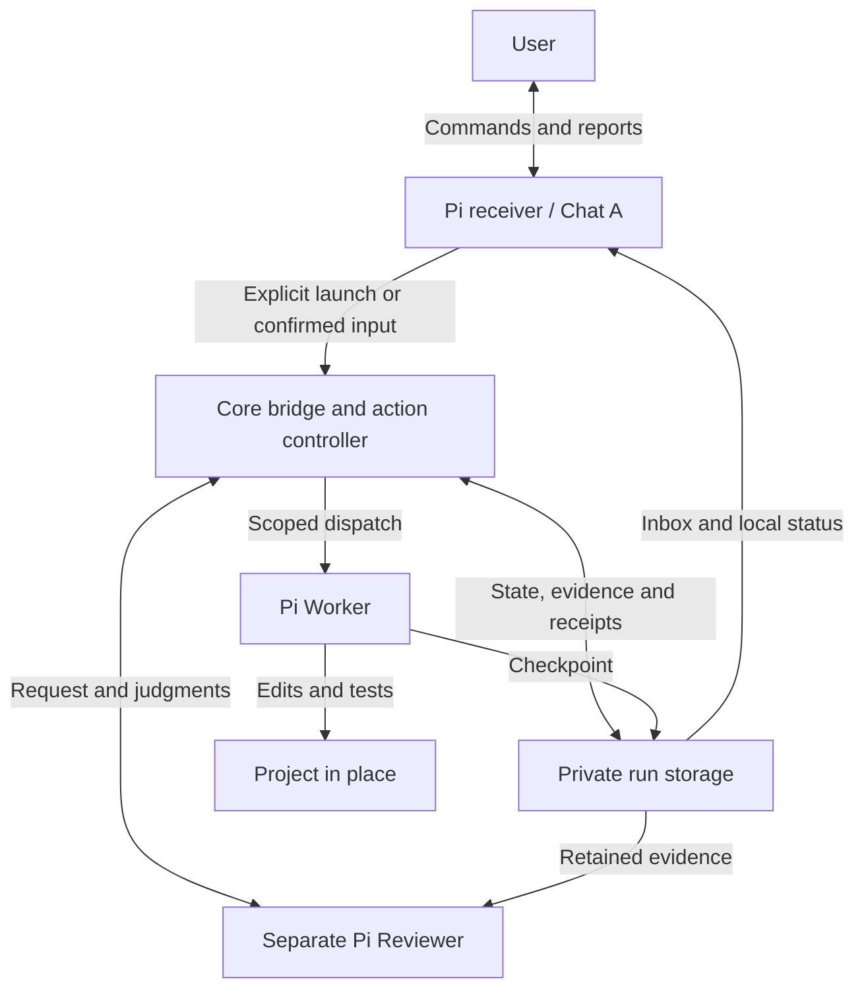
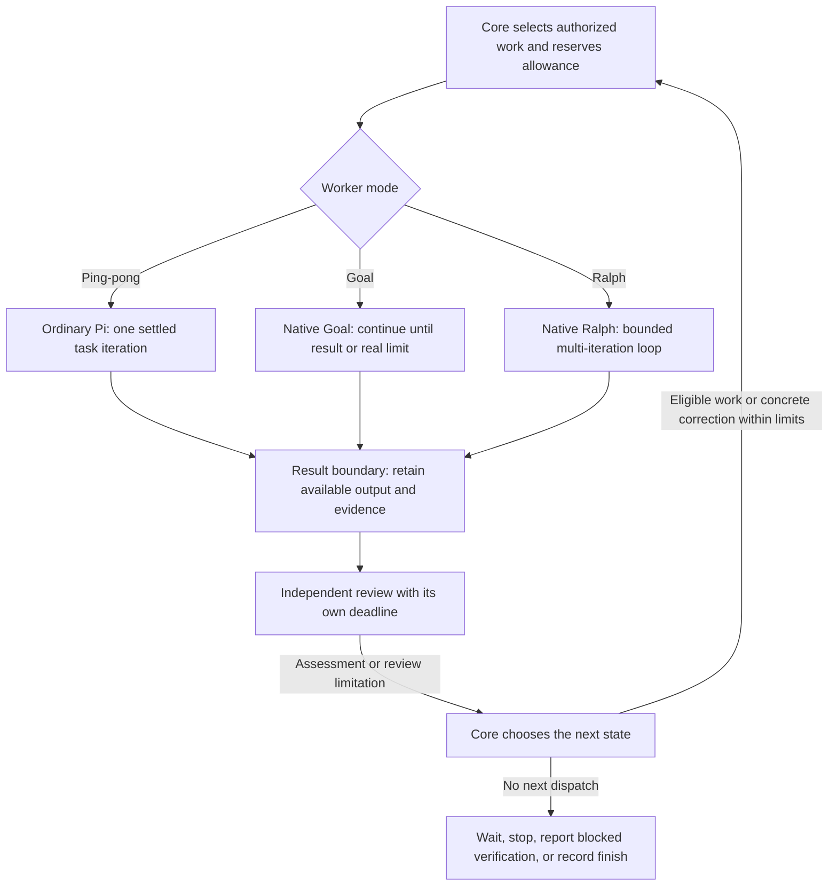
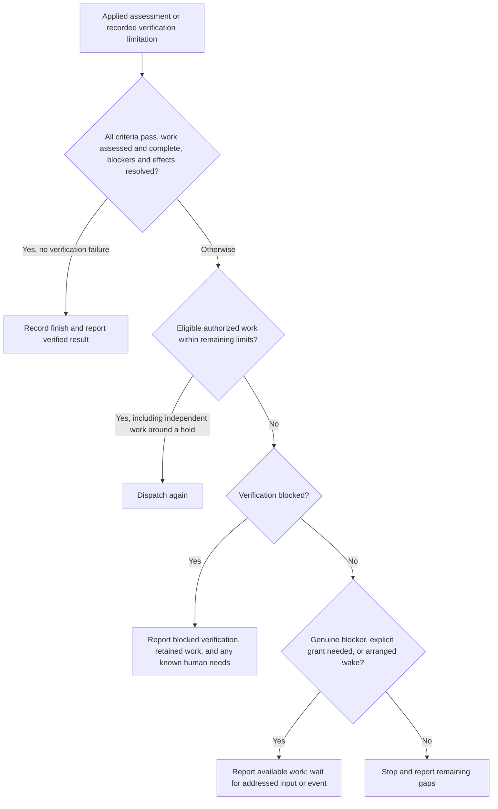
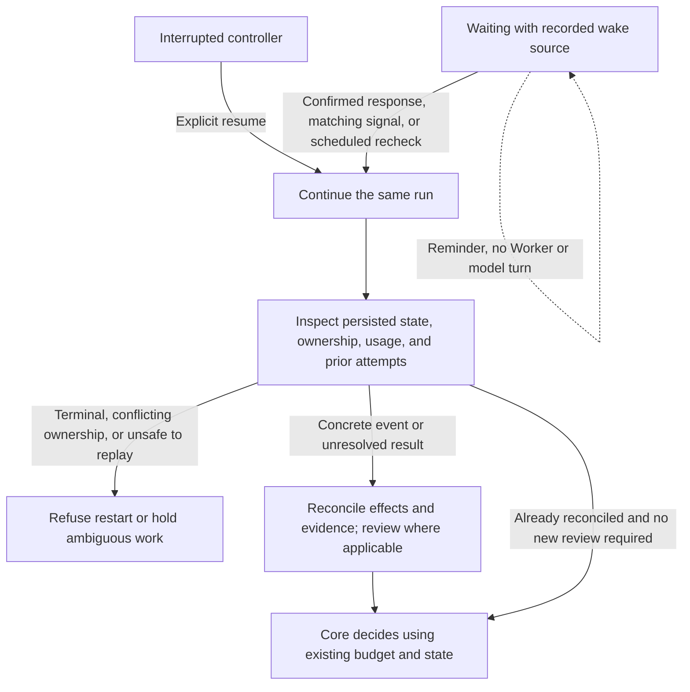

# Current architecture diagrams

These diagrams explain the [current architecture](ARCHITECTURE.md) and [run contract](../references/reviewed-runs.md). They omit lower-level states and do not establish live compatibility.

## Components and workspaces

Default Pi route with headless review. In Pi chat review, the launching chat also receives review requests. In the Codex route, `codex queue` addresses an existing thread. Both chat routes submit an assessment to Core rather than starting a headless Reviewer.

Read-only Reviewer built-in tools do not make the workspace a sandbox. Chat A is a reporting and input surface in this route, not the acceptance authority.

## Worker modes and review timing

The mode changes the Worker boundary and accounting, not the review protocol. Ordinary test results travel with Worker evidence; there is no second evaluator stage.

Native Goal progress checkpoints do not force review or split the session. Ralph reserves native iterations before dispatch; interrupted or missing native result telemetry does not release that reservation. [Observed Ralph tokens](../references/reviewed-runs.md#native-ralph-accounting-and-storage) are report-only, not allowance. See [mode accounting](../references/reviewed-runs.md#budgets-and-goal-accounting).

## Result and acceptance

The decision order below abstracts [Core's transition logic](../scripts/action_protocol.py) after a settled boundary. A technical review failure holds affected actions and work that depends on them; it is not a product defect. Explicit stop and integrity controls can preempt this flow.

With no defect, open blocker, wait, or unreconciled effect, a stop with complete actions and only `unknown`/`not_tested` criteria remaining can be `delivered_unverified`. Not every stop or verification failure uses that outcome. A successful run report and successful report delivery are different facts.

## Wait and recovery

This shows wake and resume, not an automatic rerun on reopening the UI. Concrete human/resource events and recoverable unassessed results can require independent reconciliation. An idle, reconciled run does not need repeated review simply because Core resumed.

A durable review attempt is not permission to resend. An uncertain operation is not proof it failed. Late input cannot restart terminal work. See [waits and recovery](action-scoped-protocol.md#budgets-waits-and-recovery).
