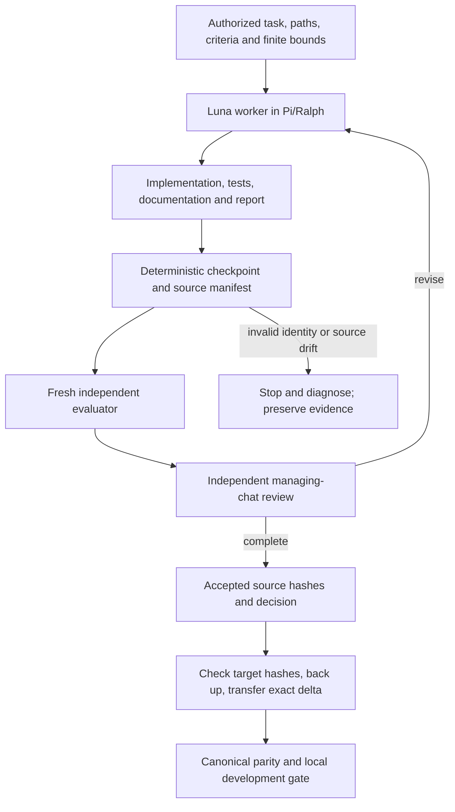

# Launch and status visibility: implementation and dogfooding report

Date: 2026-10-18. Times below use Europe/Warsaw.

**Outcome:** the first visibility feature passed independent A1–A7 acceptance in an isolated source snapshot. Its remaining three-file delta was subsequently transferred to the canonical checkout and verified there. Runtime installation and live Pi TUI verification remain pending.

This retrospective was written after canonical delivery. It records the process and evidence boundaries; it was not itself part of the cycle-6 acceptance artifacts. Raw run records remain in ignored private storage.

## 1. Intended result and scope

The feature addresses a practical problem: after launching PPP, the managing chat could fall silent, leaving the user to invoke `/ppp-status` manually to understand what was happening.

The accepted scope comprises:

| Criterion | Delivered behavior |
|---|---|
| A1 | Distinguish launch accepted from actual worker/session startup confirmed; report spawn errors, early exit and bounded startup timeout; preserve duplicate-launch refusal. |
| A2 | Update Pi's native footer through a PPP-specific `ctx.ui.setStatus()` key, preserving other extensions and token/context UI. Show readable run name, phase, cycle/maximum and elapsed time. |
| A3 | Present starting, working, evaluating, review/input waits, terminal and unknown states honestly; validate identity and handle missing/legacy metadata. State age is not represented as last worker activity. |
| A4 | Provide readable local status through all three status aliases, including roles, cycle budget, available timing, paths, reason and next action. Deduplicate project/attached runs by canonical path. |
| A5 | Notify significant launch, terminal and blocker transitions without model turns or repeated polling/reload spam. Keep notification receipts separate from checkpoint-delivery receipts. |
| A6 | Add meaningful deterministic regression coverage while retaining existing protocol, receiver, installer and compatibility checks. |
| A7 | Document actual behavior and limitations, and provide a requirement-to-evidence audit. |

All product UI is English. Stop controls, package installation improvements, archive/delete, `single`, spec-run, shared Trusted Artifact Generation and compact managing-chat callbacks were not added by this feature.

The seven feature files are the [receiver](../extensions/pi-reviewed.ts), [bridge](../scripts/bridge.py), [receiver tests](../scripts/test_pi_receiver.mjs), [bridge tests](../scripts/test_bridge.py), [README](../README.md), [skill](../SKILL.md) and [run contract](../references/reviewed-runs.md).

## 2. Execution and acceptance process

Pi/Ralph executed the worker with `openai-codex/gpt-6-luna`; the independent managing-chat reviewer used `gpt-6.1-sol`. The controller retained explicit run identities, cycle limits, deadlines and review records.

This diagram describes the final experimental workflow. Early attempts still relied on worker-authored checkpoint identity and manifest data. A run-local deterministic helper was introduced during recovery preparation; it is not a shipped shared artifact-generation feature.

The worker's completion claim was never sufficient. The bridge evaluated a saved checkpoint freshly, and the reviewer independently checked the logical result. A failed evaluator could not be converted into completion by reviewer confidence. Conversely, evaluator exit 0 did not prevent a reviewer from requesting concrete corrections.

Earlier supervisors, tasks, evaluators, checkpoint history and baselines were retained. Candidate source did not replace the active supervisor. Follow-ups used new run identities; stopped runs were not silently replayed. Budget increases and the later replacement of an expired deadline followed explicit user continuation/restart authorization.

## 3. Intermediate runs and results

These are six linked attempts at one feature, not six independent benchmark tasks. A native Ralph iteration can contain multiple model turns and tool calls.

| Run | Native iterations used / cap | Recorded outcome | Intermediate result |
|---|---:|---|---|
| `start-status-luna` | 3 / 3 | `stopped` | Partial implementation; footer formatting, detailed status, notifications and documentation were not yet accepted. The configured cycle budget was exhausted. |
| `start-status-followup-luna` | 4 / 6 | `attention_required` | Startup was independently accepted at cycle 3. Footer behavior had test evidence, but cycle 4 supplied the directory name instead of the run UUID; the bridge rejected the checkpoint before final acceptance. |
| `start-status-recovery-luna` | 1 / 2 | `attention_required` | Further status, notification, test and documentation work was produced. Unrelated shared-checkout documentation drift made the protected helper refuse checkpoint generation; fresh bridge evaluation/review did not occur. |
| `start-status-final-luna` | 1 / 1 | `stopped` | A valid checkpoint and green evaluator reached review. Independent checks found terminal-phase precedence and repeated-blocker notification defects. No authorized cycles remained. |
| `start-status-fix-luna` | 1 / 12 | `attention_required` | The A3/A5 corrections passed a targeted independent check. Another change to unrelated documentation invalidated the baseline before checkpoint creation. This was not cycle exhaustion. |
| `start-status-isolated-luna` | 6 / 11 | `complete` | A standalone source snapshot removed the shared-document dependency. Review/fix cycles continued automatically and ended with independent A1–A7 acceptance at cycle 6. |

Startup acceptance and footer test evidence were intermediate results. They did not retrospectively make rejected checkpoints valid or establish acceptance of the full feature.

The shortened base revision and incorrect run identity observed during the broader sequence motivated deterministic generation of the full Git object ID, current run/cycle identity and source hashes. Rejected historical artifacts were preserved rather than edited to pass.

## 4. What independent review found

| Finding | Observed failure | Correction and evidence |
|---|---|---|
| Terminal phase precedence | A completed run with stale `phase=evaluating` appeared to be evaluating in the footer and details. | Permit evaluation phase only for compatible running state; independently exercise terminal, waiting, starting and unknown cases. |
| Repeated human blockers | `waiting_human` → work → `waiting_human` in a later cycle produced no new notice. | Persist meaningful state/cycle/reason and observed-transition information. Test new blockers, changed reasons, re-entry, reload and timestamp-only refresh. |
| Detailed-status validation bypass | Duplicate UUIDs and missing identity could regain an active label when the formatter reread raw status after earlier validation rejected it. | Preserve validated unknown/malformed state and require explicit matching identity before using lifecycle metadata. |
| Legacy compatibility regression | A UUID-only correction hid known cycle, timestamps and reason for supported external string IDs such as `Test-legacy-run`. Empty identity could still fall back to a cached active state. | Use the bridge-compatible safe-string contract while retaining UUID requirements for newly named runs; invalid identities fail closed. |
| Restored subscription validation | Saved external bindings with empty/unsafe IDs could publish active/completed footer state and a false completion notice. | Apply compatible identity validation during restoration and polling, before presentation and notification. |
| Ineffective regression fixture | Invalid bindings were appended to an array that the session mock never returned. The assertions therefore did not exercise the intended branch. | Use a dedicated `getEntries()` context returning the actual invalid entries and a valid legacy control; assert restoration, positive behavior and absence of invalid side effects. |
| Incomplete final report | A focused test-fix report omitted the required A1–A7 coverage. | Restore the complete criterion/evidence audit and generate a fresh checkpoint. The evaluator then ran all checks again. |

Several product/test defects were found after evaluator exit 0. The useful observation is specific: independent review added coverage in this case. It is not a general estimate of reviewer accuracy or proof that all defects have been eliminated.

### Final isolated run, cycle by cycle

| Cycle | Fresh eval | Decision | Reason |
|---:|---:|---|---|
| 1 | 0 | `revise` | Detailed status bypassed duplicate/missing-identity validation. |
| 2 | 0 | `revise` | The correction broke safe legacy IDs and retained an invalid-identity fallback. |
| 3 | 0 | `revise` | Restored bindings still lacked corresponding identity checks for footer/notices. |
| 4 | 0 | `revise` | The new persistent regression did not actually return its invalid fixtures from the session mock. |
| 5 | 1 | `revise` | A1–A7 report coverage was missing; the evaluator stopped before running its test commands. |
| 6 | 0 | `complete` | Coverage restored; full fresh checks passed against unchanged implementation and the corrected regression. No blocking findings remained. |

No source changes were required in cycle 6. This was valid finalization of evidence, not fabricated progress.

## 5. Isolation and recovery lessons

The repeated documentation failures came from an overly broad acceptance boundary: unrelated shared-checkout documents were pinned alongside the feature. Their changes were real integrity mismatches, so the guard correctly refused the state. However, coupling those documents to this feature created unnecessary execution failures. The run records do not establish which process authored each concurrent document change.

The final attempt used a standalone local Git clone overlaid with copied current source. It was not a worktree and created no new commit. Snapshot copies of unrelated documents stayed fixed; subsequent canonical documentation edits could not change them. Canonical feature-file hashes were still checked to prevent overwriting concurrent implementation changes during delivery.

The snapshot reused installed dependencies through local links. Task boundaries, private directories and hash checks were cooperative controls, not an enforced OS security sandbox. This run does not establish malicious-worker isolation or protected evaluator dependencies.

Recovery remained a supervised preparation of linked new runs. Automatic crash recovery, safe replay of arbitrary side effects and unattended multi-project operation were not demonstrated. Separate worktrees are the intended next approach for concurrent implementation work.

## 6. Final verification and canonical transfer

Cycle 6's fresh bridge evaluator passed:

- `git diff --check`;
- `npm run check`, covering lint, TypeScript, Ruff, 15 bridge tests and the receiver suite with existing compatibility/installer checks;
- protected startup, footer, detailed-status/lifecycle and A3/A5 review-regression harnesses;
- checkpoint/evidence identity and hashes, complete source manifest, protected-input integrity, unchanged HEAD/index, allowed scope and preserved snapshot files.

The reviewer also checked the logical findings and regression wiring. The final decision was `complete`, tied to cycle 6's checkpoint hash. This accepted source and API behavior; it did not claim live visual TUI correctness or a new live Goal compatibility result.

Before canonical delivery, all three targets still matched the recorded starting hashes. The accepted snapshot and its evidence remained intact; supporting source and dependency configuration matched. Path checks found regular files with matching `0644` modes and no symlink/hardlink substitution in the three transfer paths.

Only the outstanding delta was copied:

1. `extensions/pi-reviewed.ts` — final identity validation corrections;
2. `scripts/test_pi_receiver.mjs` — corresponding meaningful regressions;
3. `references/reviewed-runs.md` — compatible legacy ID documentation.

Private backups and a transfer record were saved before replacement. Each file was replaced atomically after another target-hash check. Verification confirmed all seven feature files matched the accepted manifest and 22 other tracked/nonignored files were unchanged. HEAD and the index were preserved. Canonical `npm run check` and `git diff --check` then passed.

At retrospective verification, canonical feature hashes still matched the accepted manifest. The installed Pi receiver and installed skill bridge differed from canonical source; this workflow had not updated runtime copies. No feature commit, push, release or publication was performed.

## 7. Measurements and limits

| Measurement | Recorded result |
|---|---|
| Feature attempts | 6 linked runs |
| Native worker iterations | 16 total |
| Final isolated attempt | 6 iterations, approximately 22 minutes |
| Sum of recorded run durations | Approximately 62 minutes |
| Token usage, monetary cost, human minutes | Not consolidated/measured for this report |

Durations run from recorded bridge start to terminal state and include evaluation and reviewer waits. They exclude preparation, manual recovery work and pauses between runs; they are not worker compute time or total delivery lead time. The canonical transfer was recorded at 11:18 Warsaw on 2026-10-18. The earlier run chronology spans additional hours of pauses and preparation.

There was no paired standalone comparison, fixed benchmark sample or measured cost reduction. One accepted feature after six linked attempts is not a six-task completion-rate experiment.

## 8. Remaining work

For this accepted implementation, update runtime copies and verify the visible footer/notifications after Pi reload. Keep visual acceptance distinct from the API tests already passed.

The [roadmap](ROADMAP.md) separately plans shared Trusted Artifact Generation and compact managing-chat callbacks. The run-local helper is only an experimental precursor. Future worktree use should remove shared-checkout collisions while preserving source-bound review and safe delivery checks. These follow-ups are not claimed as implemented by this feature.

## Evidence locations

Repository source references are linked above. Detailed local evidence remains ignored/private and is not bundled into this report:

- `.pi-ping-pong/runs/<run-name>/bridge-status.json` and compact `bridge-events.jsonl` for the six named attempts;
- `.pi-ping-pong/runs/start-status-isolated-luna/reviews/006/` for the final request, decision and fresh evaluator output;
- `.pi-ping-pong/runs/start-status-isolated-luna/work/` for the accepted report and source manifest;
- `.pi-ping-pong/transfers/accepted-start-status-20261018T091858Z-1cd79e9b/` for original-file backups and transfer verification.

Those local evidence paths are not portable public links. Raw worker transcripts, credentials and unrelated project artifacts were not copied into this retrospective.
