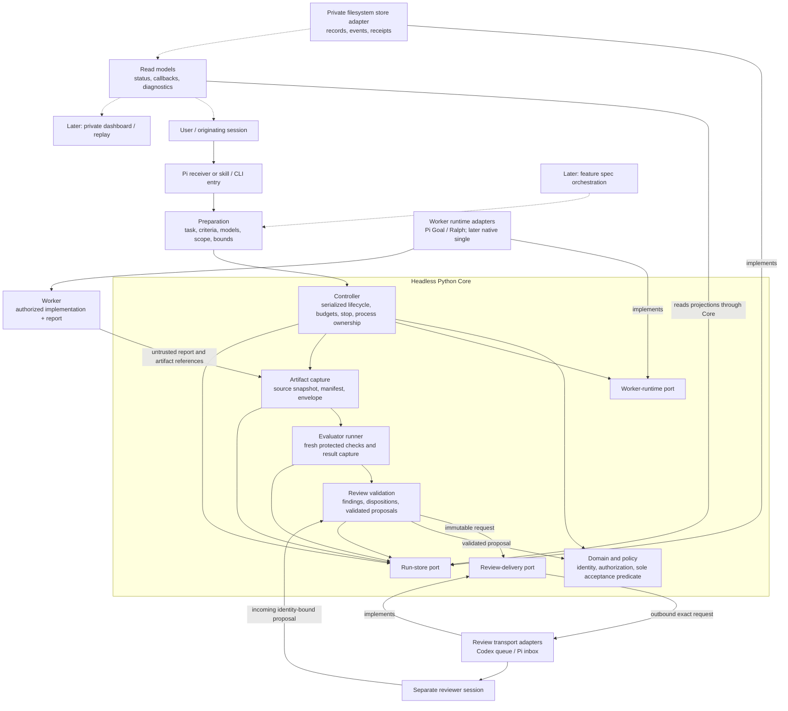
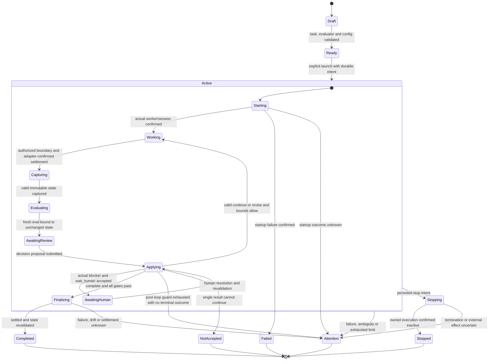
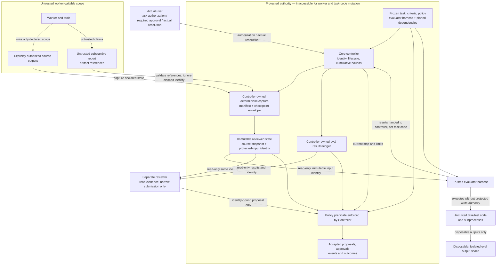
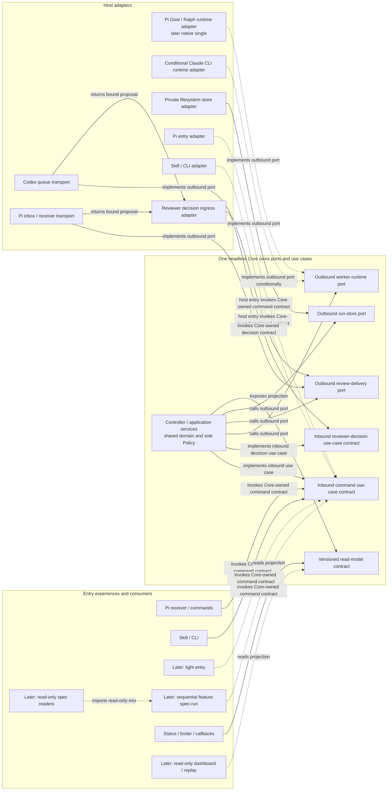
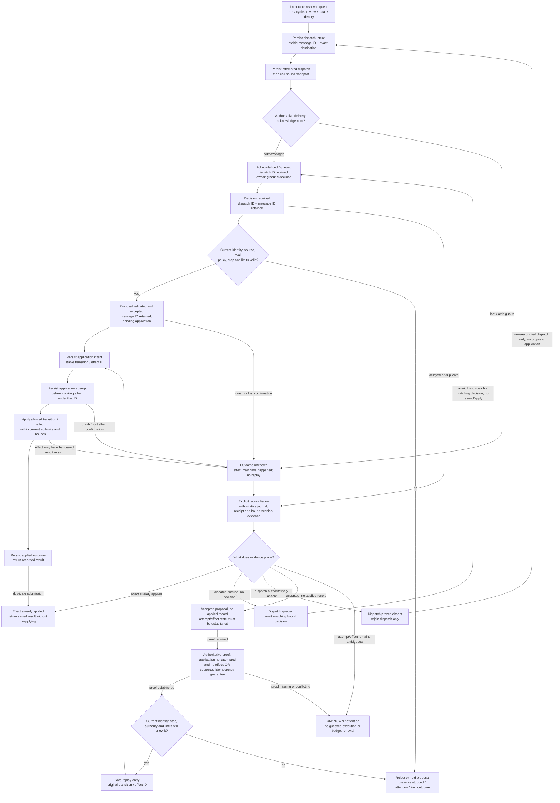

# Pi Ping Pong — Architecture Diagrams

Date: 2026-10-18 · Architecture revision: 1

This atlas is the **normative To-Be** view of the [target architecture](../ARCHITECTURE.md), not evidence that every component or transition is implemented. The architecture document owns decisions; the [roadmap](../ROADMAP.md) owns delivery order. The [run contract](reviewed-runs.md) describes current operation. Labels are conceptual unless they name an existing interface.

| View | Question answered | Architecture reference |
|---|---|---|
| [D1 — Components](#d1--components-and-ownership) | Where does each responsibility live? | Sections 3–4 |
| [D2 — Review cycle](#d2--work-evaluation-and-review) | How does work become an accepted result? | Sections 5–6 |
| [D3 — Run states](#d3--run-lifecycle) | What can run, wait, stop or finish? | Section 7 |
| [D4 — Trust](#d4--trust-and-write-boundaries) | Who can write source, evidence and decisions? | Sections 6 and 8 |
| [D5 — Extension points](#d5--extension-points-with-one-core) | How do new runtimes and interfaces reuse Core? | Sections 5 and 9–10 |
| [D6 — Durable delivery](#d6--delivery-and-uncertain-outcomes) | What happens when a message or acknowledgement is lost? | Section 8 |

## D1 — Components and ownership

Solid arrows show calls/data flow. Dashed arrows show optional/future integrations. Boxes group responsibilities, not separate services or repositories. Core owns the ports it defines; concrete adapters implement those ports (see D5).

Policy defines the sole acceptance predicate; the controller enforces it against controller-captured identity, fresh evaluator results, reviewer evidence and required authorization. Review validation does not create a second acceptance authority. The controller schedules capture/evaluation/review and serializes transitions; pipeline arrows grant no independent lifecycle ownership. Goal/Ralph share the acceptance path. A transport receipt proves delivery state only, never review or acceptance.

## D2 — Work, evaluation and review

One bounded run is shown. The loop belongs to the controller, never to transport or reviewer. Its guard requires confirmed startup, no terminal outcome and remaining original bounds; confirmed startup failure/unknown state and completed/non-success outcomes make that guard false. Identity is controller-generated and binds run, cycle, reviewed state, protected criteria/evaluator/dependencies and source snapshot throughout evaluation and review.

```mermaid
sequenceDiagram
    autonumber
    participant O as Originating session
    participant C as Core controller
    participant W as Worker adapter
    participant S as Private run store
    participant E as Trusted evaluator harness
    participant R as Separate reviewer

    O->>C: Explicit launch of validated task, scope and finite bounds
    C->>S: Persist launch intent and controller-generated run identity
    C->>W: Start worker under declared permissions
    alt Actual worker and session identity confirmed
        W-->>C: Confirm worker/session identity
        C-->>O: Confirmed-start report
    else Startup failed
        W-->>C: Authoritative failure evidence
        C->>S: Persist startup failure and non-success outcome
        C-->>O: Failure report, no automatic relaunch
        C->>C: Mark startup terminal and execution guard is false
    else Startup confirmation unknown
        W-->>C: No authoritative confirmation
        C->>S: Preserve launch intent and unknown execution state
        C-->>O: Attention report, reconcile before any new action
        C->>C: Mark outcome unknown and execution guard is false
    end
    loop Only while startup is confirmed, no terminal outcome exists, and original cycle and wall-time bounds allow execution
        C->>W: Execute one authorized logical result or correction
        W-->>C: Substantive report, artifact references, adapter-confirmed settlement
        Note over C,W: Goal boundary is accepted goal_wait plus settlement<br/>Ralph boundary is one completed native iteration plus settlement<br/>A checkpoint alone does not prove settlement
        C->>C: Validate report and capture frozen source and protected-input identity
        C->>S: Persist immutable checkpoint and reviewed-state identity
        C->>E: Evaluate that exact state with fresh protected checks
        E-->>C: Criterion results, exit status and evidence references
        C->>C: Controller captures results and verifies input identity unchanged
        C->>S: Persist eval record bound to reviewed-state identity
        C->>S: Persist review request and dispatch intent
        C->>R: Deliver exact request bound to run, cycle and reviewed state
        Note over C,R: Receipt proves enqueueing only, not review or acceptance
        R->>S: Read authorized task, snapshot, eval and relevant evidence
        R-->>C: Identity-bound decision proposal and findings
        C->>C: Validate identity, state, policy, stop and original limits
        opt Actual missing input, access, approval or material choice
            C->>S: Record wait_human without renewing limits
            C-->>O: Ask precise question for actual human resolution
            O->>C: Record actual resolution within existing scope and bounds
            C->>R: Submit resolution and current evidence for review
            alt Resolution changes protected inputs or source
                C->>C: Invalidate affected snapshot, eval, review and approvals
                C->>C: Recapture state and run fresh evaluation
                C->>S: Persist new identity-bound review request
                C->>R: Request updated proposal for the new reviewed state
            else Reviewed state unchanged
                C->>R: Request updated proposal bound to unchanged reviewed state
            end
            R-->>C: Updated identity-bound proposal
            C->>C: Revalidate all gates without extending bounds
        end
        alt Valid complete and all required acceptance evidence holds
            C->>S: Persist acceptance for this immutable reviewed state
            C->>W: Finalize without further implementation work
            W-->>C: Finalization outcome and execution settlement
            C->>C: Revalidate identity, frozen state, bounds, stop and finalization evidence
            alt Finalization settled and every gate still passes
                C->>S: Persist completed outcome and callback intent
                C-->>O: Verified completion with evidence references
                C->>C: Persist terminal completed state and make next loop guard false
            else Finalization failed, drifted, stopped or remains unknown
                C->>S: Persist honest non-success or unknown outcome and reason
                C-->>O: Finalization failure or attention with evidence references
                C->>C: Persist terminal non-success state and make next loop guard false
            end
        else Valid continue or revise and another execution is allowed
            C->>S: Persist applied decision and next bounded cycle intent
        else Stop, exhausted limit, failed gate, ambiguity or single-mode non-success
            C->>W: Stop or settle owned execution as safely possible
            C->>S: Persist honest non-success outcome and reason
            C-->>O: Outcome and concrete next action
            C->>C: Persist terminal non-success state and make next loop guard false
        end
    end
    opt Loop guard is false after the final allowed continue or revise and no terminal outcome exists
        C->>C: Reconcile persisted stop and original cumulative bounds
        C->>S: Persist exhausted or stopped non-success outcome
        C-->>O: Report terminal outcome and concrete next action
        C->>C: Persist terminal non-success state without another execution
    end
```

For `single`, policy permits one worker execution: a failed eval, findings, or human resolution cannot authorize another execution; report non-success or await a real blocker within the original deadline. Any validation failure takes the safe failure path. Finalization failure/drift invalidates verified completion even if an acceptance record was previously persisted. Persisted stop intent wins over late review. Unknown execution outcome is not proof of inactivity; reconciliation is explicit and cannot renew bounds or relaunch without authority.

## D3 — Run lifecycle

Conceptual states only; compatibility adapters may map stored values without renaming them. `Attention` is an external destination, not a child of `Active`. Unknown process/effect state stays distinct from confirmed inactivity.

`NotAccepted` is a conceptual non-success outcome, not a claim about a shipped field. `Completed` requires the sole Policy predicate enforced by Controller: current identity and unchanged reviewed state, fresh passing required checks, separate reviewer evidence, required authorization, no stop/exhausted limit, and safe settled finalization. Stop may be user initiated or a valid review stop; persist intent first and give it precedence over late decisions. `single` never loops to another execution. A deadline bounds active and human waits; downtime counts and cannot renew the deadline. Unknown execution/effect outcomes require evidence-based reconciliation before archive, deletion or any recovery action. Reconciliation can establish inactivity or a safe authorized continuation, but neither permanent closure nor automatic resume is inferred from `Attention` or a terminal label.

## D4 — Trust and write boundaries

This is the desired enforced profile. The enforcement mechanism is open, but the boundary is not weakened: task/test code and subprocesses are untrusted execution even when invoked by a trusted evaluator harness. No untrusted code inherits write authority to criteria, harness/dependencies, immutable snapshot, results ledger or control state.

The evaluator harness is trusted and controller-pinned; executing repository/task tests is not. The harness must prevent those tests, tools, dependencies and subprocesses from writing or substituting protected inputs or controller-owned results. Controller captures results and rechecks immutable input identity across eval, review and finalization. There is no worker/reviewer write path to trusted criteria, snapshots or accepted records. Hashes identify content; they do not enforce access or prove provenance. OS-level restricted execution or another demonstrably enforced host profile are open mechanisms; until selected and negatively tested, do not claim an enforced deployment or silently downgrade the target.

## D5 — Extension points with one Core

Arrows distinguish dependency and implementation, not runtime execution order. **Core owns ports**. Concrete filesystem, runtime and transport adapters implement those ports. Entry experiences and adapters depend inward on Core contracts; Core/domain does not depend on concrete storage, host UI, runtime or transport APIs. Inbound decision submission is distinct from outbound review delivery.

These are contract relations, not a sequence diagram. An implementation link does not mean the adapter owns execution policy or that Core depends on that implementation. A reviewer returns a decision through the inbound submission port and a bound adapter; outbound delivery sends immutable review requests to a reviewer host. Conditional Claude worker support does not establish reviewer or return-channel support. `single` uses native Pi without Goal/Ralph dependencies. Future UI actions submit scoped Core commands; a spec reader cannot grant authorization. No current-entry/status comparison changes the normative target.

## D6 — Delivery and uncertain outcomes

Controller run state and transport delivery state are separate. Each decision is validated against current run/cycle/reviewed-state identity and gates. Durable states distinguish receipt, validation/acceptance, application intent, applied result and unknown outcome.

A queue receipt proves enqueueing only. Delayed or duplicate decisions must match exact run, cycle, reviewed-state, dispatch and message identity; conflicts cannot create a second transition. A queued dispatch with a lost acknowledgement is reconciled to waiting for its bound decision, with no duplicate send or application. A dispatch proven absent can rejoin dispatch only; it cannot apply an unreceived or unvalidated proposal. A validated proposal's acceptance is not an effect result: absent applied-result evidence, non-idempotent effects whose attempt/effect status is ambiguous remain UNKNOWN/attention. Safe application requires authoritative proof that the application was not attempted and had no effect, or a separately supported idempotency guarantee; current authorization, stop, time and identity gates do not prove effect absence. Under the original stable transition/effect ID, initial and safe replay applications share the same durable `ApplyIntent` -> `ApplyAttempt` -> `Apply` -> applied-or-unknown path. Reusing a matching intent is idempotent; conflicting intent creation is rejected. A crash/lost confirmation during either initial or replay application returns to unknown/reconciliation. Already-applied effects return the stored result without reapplication. Reconciliation is explicit and bounded: it is not blind resend, budget renewal, or a claim that arbitrary external effects happen exactly once.

## Cross-view invariants and open questions

Across all views, one controller-generated identity binds run, cycle and exact reviewed state, including protected task/criteria/evaluator/dependencies and source snapshot. Policy defines the sole acceptance predicate and Controller enforces it. Capture and fresh evaluation are controller scheduled; results are controller captured; Reviewer supplies a separate evidence-bound proposal; inbound validation and outbound delivery are different responsibilities. Passing functional eval, native completion, queue acknowledgement or human response alone never establishes acceptance. Actual human resolution addresses a genuine missing input/access/approval/choice, stays within original authorization and bounds, and is sent to Reviewer for an updated state-bound proposal; changed protected inputs/source invalidate and require recapture, fresh eval and new review identity. Stop and cumulative finite limits take precedence over late work. Uncertain process or effect outcomes stay distinct from inactivity and require explicit evidence-based reconciliation.

Open questions (implementation mechanisms and material product choices remain unresolved):

- Which supported host mechanism enforces worker and task/test-code isolation, including tools, subprocesses and dependencies? Options include OS-level restricted execution or another demonstrably enforced host profile. The required boundary remains; until a mechanism is selected and negatively tested, do not claim enforcement or silently downgrade.
- What versioned snapshot, event, proposal/application and reconciliation schemas, atomicity/flush rules and crash/clock semantics implement the invariants? Identity allocation/versioning and migration need explicit contracts; no option permits blind retry or budget reset.
- Which risk thresholds, sensitive paths, approval requirements and approval invalidation rules apply? Options change required human evidence; no threshold or approval policy is implied here.

## Maintenance

Update affected diagrams when architecture ownership, state transitions, trust or delivery semantics change. Keep the architecture revision aligned with [ARCHITECTURE.md](../ARCHITECTURE.md). Diagrams explain the contract; source/tests/run artifacts establish implementation evidence. No runtime or policy change is authorized by adding a node or arrow.
